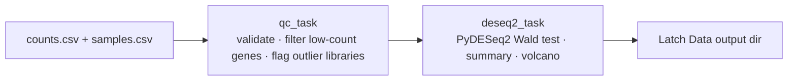

# Bulk RNA-seq Differential Expression on Latch

A [Latch](https://latch.bio) workflow that takes a featureCounts gene × sample
matrix and a sample sheet, then runs QC and a **PyDESeq2** Wald test and writes a
results table, a summary and a volcano plot to Latch Data.

It is the downstream half of my Nextflow pipeline
[bulk-rnaseq-differential-expression](https://github.com/arashmparsa/bulk-rnaseq-differential-expression)
(FastQC → Trimmomatic → STAR → featureCounts), moved onto Latch so a bench
scientist can run DE from a form instead of a terminal.

**Validated against ground truth:** on simulated negative-binomial counts with 100
planted DE genes (4 vs 4 samples, 4× fold change), the workflow recovers
**97% of planted genes at 95% precision** (FDR < 0.05). See `tests/test_core.py`.

## Workflow



| Task | Resources | What it does |
|---|---|---|
| `qc_task` | small | Checks the sample sheet matches the matrix, counts are raw integers and there are exactly two conditions; keeps genes with ≥10 reads in ≥2 samples; flags libraries with robust z > 3 |
| `deseq2_task` | medium | Size factors → dispersion shrinkage → negative-binomial GLM; contrast = treated vs reference; Cook's-distance refit |

## Run it

```bash
pip install -r requirements.txt
pytest -q                       # local tests, no Latch account needed
latch login && latch register . # push to your Latch workspace
```

Inputs: `counts.csv` (first column gene id, one column per sample) and
`samples.csv` (first column sample id, plus a `condition` column).

## Design decisions

- **Science separate from orchestration.** All analysis lives in `wf/core.py` (plain pandas/PyDESeq2) and is unit-tested locally. `wf/__init__.py` only moves files between Latch Data and the container.
- **Validate inputs before anything runs.** Using normalized values instead of raw counts is the most common way DESeq2 gets misused, so the QC task rejects non-integer counts.
- **Robust outlier detection.** Library sizes are scored with median/MAD instead of mean/SD, so one failed library can't widen the spread and hide itself.
- **PyDESeq2 instead of R DESeq2.** It's the same statistical model, and keeping one Python image makes the container smaller and faster to start on Latch.
- **Ground-truth tests.** Instead of checking that code "runs", the tests plant DE genes and measure recall and precision.

## License
MIT
